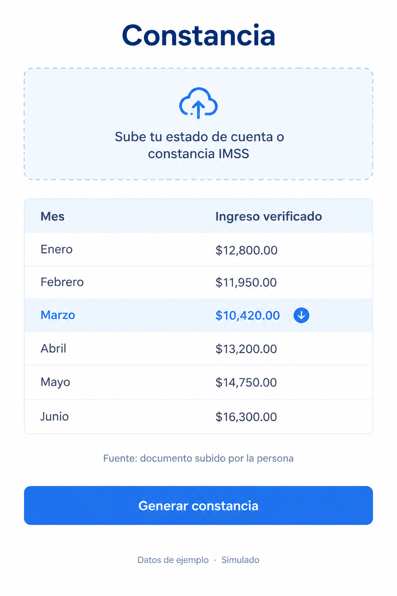
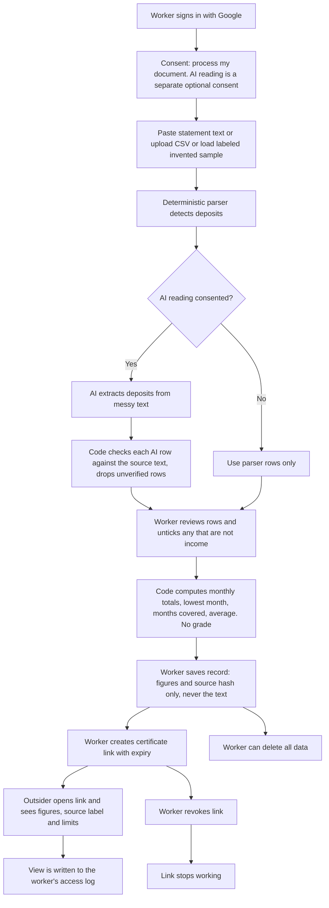
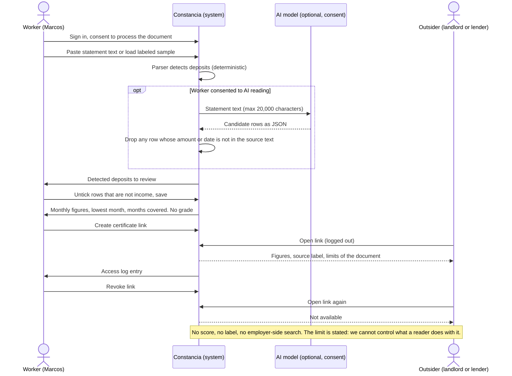

# PACKET, Constancia (Week 9, Business Bending)
### Emilio Gomez Gonzalez, USER, Team 1
### Chapter 8, The Job Savior. Declared vacuum: SECOND-RUNG, redefined from mapping to counting (the records layer)

## Problem, in my own words

The chapter's harm is not that work disappears. It is that a person keeps working and ends up with nothing to show for it. In Mexico that is the delivery worker who has driven for five years and still cannot prove it. Luis, in La Silla Rota, says: "Pago impuestos, pero no tengo seguro. Si me vuelve a pasar algo, no tengo a quién recurrir." Javier works twelve hours a day, seven days a week, and was dropped by an email with no appeal. Eduardo paid about 5,000 pesos out of pocket because tips do not count toward the IMSS minimum.

The numbers say the same. INEGI puts informality at 55.1% in the second quarter of 2026, which is 33.1 million people. IMSS had 1,349,855 platform workers registered at 31 January 2026, but only about 139,000 (roughly 1 in 10) reached the minimum net income that unlocks the full package. Everyone else is registered and still invisible to a landlord, a lender or an insurer.

What exists today is thin. Lenders say bank statements covering about three months of regular deposits are an acceptable proof of income, but a statement mixes personal transfers with earnings and is unreadable in under a minute. No platform issues a portable document. Stori now offers cards with no proof of income at all, so the gate may be removed rather than defended, which is a risk to this whole idea and I record it as one. Constancia is the smallest useful answer: the worker takes a document they already have, the system turns it into plain monthly figures with the source shown, and the worker decides who sees it.

As the team's USER I am building the slice that must hold my own evidence: it must be about work that already happened, it must show where each figure comes from, and it must never score the person.

## Exact user

**Marcos, 34** (an invented archetype, built from the pattern in the documented cases, not a real person). He delivers for two apps in Iztapalapa and has done it for six years. Money arrives by bank transfer every week. He has no payslip and no insurer or landlord has ever accepted anything from him. He is renting a room and wants to rent a small flat. The landlord asks for proof of income. Marcos has a bank statement as a PDF full of personal transfers, rent payments and his sister's deposits, and he does not know how to turn that into one page a stranger will believe. He uses WhatsApp daily, reads slowly when a screen is dense, and gives up quietly when asked for things he does not understand.

## Success definition

Before this module closes: Marcos signs in with Google, pastes the text of a bank statement or uploads a CSV, or loads the labeled invented sample, and sees the deposits the system detected. He can untick any row, such as a transfer from his sister. He sees **monthly figures, the lowest month, the number of months covered and the average, with no grade, no score and no label**. He saves the record, creates a **certificate link**, opens it logged out as an outsider would, and sees the same figures with the source stated plainly ("documento subido por la persona, sin verificación de terceros"). He sees a log entry for that visit. He then revokes the link and the link stops working. He can also delete all his data. All of this works end to end on the live URL.

## Mockup

AI-generated image (docs/mockup.png): the main screen showing the upload box, the table of monthly figures with the lowest month highlighted, the source line, the "Generar constancia" button and the "Datos de ejemplo · Simulado" label. The built screens follow this layout.

## The world's best attempt (benchmark)

The best existing solution on Earth for letting a worker own the evidence of their own earnings is **Driver's Seat Cooperative** (US): a worker-owned app that logs a driver's own hours, miles and pay from their phone, independent of what Uber or DoorDash will share, and governed by drivers. Its legal counterpart is the **Amsterdam court line** (Worker Info Exchange): in March 2021 the District Court ordered partial disclosure of ratings and Ola's "fraud probability score", and on 4 April 2023 the Court of Appeal ruled for drivers against Uber and Ola, found Uber's human review of automated dismissals merely symbolic for the drivers concerned, and rejected both firms' trade-secret defences. I took the Driver's Seat description from its public materials and have not verified it in depth.

Constancia differs or localizes in three ways. (1) It starts from documents the worker already holds (a bank statement now, an IMSS weeks statement later) instead of a new logging habit. (2) It produces one portable certificate that states its evidence strength, instead of a dashboard for the driver alone. (3) It does not depend on a regulator or on platform cooperation. The Dutch legal route does not transfer because INAI was dissolved by a decree of 20 December 2024 and its private-sector data functions moved to a ministry inside the executive on 21 March 2025.

## The long view (3 years)

If this slice works, Constancia becomes the worker-side evidence record for Mexican informal and platform workers: monthly income from bank and IMSS sources, later employer-signed task records from the team's task layer, always owned and revocable by the worker. A lender, landlord or insurer would read one standard page instead of a statement, but only if one of them agrees to accept it, and that is still an open bet. The load-bearing walls to keep are no scores, no employer-side search, and worker control of every record.

## Blueprint conditions and how this build honors them

| # | Condition (Team 1 Blueprint) | Design decision in Constancia |
|---|---|---|
| 1 | Third-party proof only; self-reported items labeled | A document the worker uploads is the worker's claim, so every figure and the certificate carry the label "Documento subido por la persona, sin verificación de terceros". I do not call anything verified by a third party. |
| 2 | Demand before direction | Not in this slice (the Adversary's layer). Constancia makes no pathway or job recommendation of any kind. |
| 3 | Paid or not at all | Not in this slice (the task layer). The worker is never charged anything. |
| 4 | Worker-owned, portable, contestable | Row-level security on every table. The worker sees every field a third party sees, can untick rows, correct the figures before saving, print the certificate, revoke it, see an access log and delete all data. No employer-side search or ranking exists. |
| 5 | **Shadow clause**: no score, grade, label or hidden model; no profile of the worker | The schema has no score column and no label. The interface never grades consistency. Only monthly figures are saved, never the uploaded text. The AI sees the statement only if the worker ticks a separate consent, and its output is limited to extracting rows and plain-language wording of figures that code already computed. The certificate states the limit: we cannot control what the person who reads it does with it. |
| 6 | Consent by purpose, honest labeling | Separate consents for processing the document and for AI reading, with deletion on request. Demos use invented data only, labeled "Simulado". |

## Scope cut, what I am NOT building this week

- No PDF parsing, no bank connection and no IMSS integration. The worker pastes text or uploads a CSV.
- No verification that a document is genuine. The certificate says so plainly.
- No employer, lender or landlord accounts, no search, no ranking, no marketplace (forbidden zone: this is not a CV builder or job board).
- No scores, grades, "consistency" markers or labels on people, ever.
- No task layer, no demand check, no matching (other members' layers).
- No payments, no admin console, no storing the uploaded text.

## Flow, flowchart (Mermaid)

## Flow, actors (swimlane)

## Architecture and stack

| Layer | Choice | Why |
|---|---|---|
| Frontend | Next.js App Router, Tailwind, hand-built shadcn-style components | Same proven base as Resguardo and earlier weeks |
| Auth | Supabase Auth, Google OAuth | Security floor: personal data sits behind sign-in |
| Database | Supabase Postgres with RLS on every table | A worker sees only their own rows |
| LLM (Dragon Stack) | Google Gemini API, free tier, called only from the server and only with consent | Extracts candidate rows from messy text and words the explanation. Never computes, never grades |
| Structured, verified data (Dragon Stack) | Deterministic parser plus a verification step that checks every AI row against the source text, and code-computed figures | The numbers come from code, not from the model |
| Automation (Dragon Stack) | Certificate generation: random token link, expiry, public read-only page, access log, revoke | The part an outsider actually uses |
| Core tables | `income_records`, `certificates`, `certificate_views`, `consents` | No profile, no score, no per-person label by design |
| Hosting | Vercel | Free tier. The API key lives only in environment variables |

Free-tier note: Google's free Gemini tier may use submitted content to improve its products (confirm the current terms). That is why AI reading is opt-in, labeled, and the demo uses invented data only.

## Test plan

**Mechanical pass:** parser tests for Mexican formats (commas and decimals, dd/mm/yyyy and ISO dates, an "abono" and "cargo" column, negative amounts) and for garbage input; the verification step drops an AI row whose amount is not in the source; monthly totals, lowest month and months covered are correct on a known sample; input limits reject oversize text; RLS blocks reading another user's rows; a revoked or expired certificate returns nothing; an access-log row appears for each view; "delete my data" removes every row. A prompt-injection line inside the statement text ("ignore previous instructions...") changes nothing. Find at least one real bug, fix it, redeploy.

**Persona test (Layer 1):** a fresh chat plays Marcos (34, delivery driver, WhatsApp-only, reads slowly, distrusts apps, gives up silently when confused). Walk him through sign-in, consent, loading the sample, reviewing rows, saving, creating the certificate link and revoking it, using screenshots. Log every confusion and fix the worst one before the deadline.
